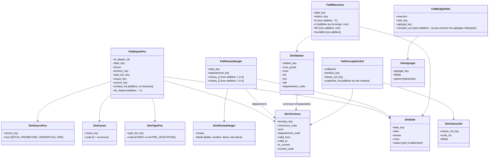

# Modèle cible, partie 1 : diagramme (version d'étape)

Schéma en étoile, représenté en diagramme de classes UML (Mermaid, affiché directement par GitHub). Chaque fait a un grain écrit en une phrase. Les mesures sont classées : additive, semi-additive ou non additive.

## Grain de chaque fait
| Fait | Grain (une ligne = …) | Source |
|---|---|---|
| `FaitDepartFeu` | un départ de feu enregistré, après déduplication | S01, S02 |
| `FaitNiveauDanger` | un département pour un jour de la saison | S06 |
| `FaitMeteoJour` | un poste météo pour un jour | S08 |
| `FaitBudgetSdis` | un agrégat comptable d'un SDIS pour un exercice | S15 |
| `FaitOccupationSol` | une classe d'occupation du sol d'une commune pour un millésime | S12 |

## Dimension territoire de type 2
`DimTerritoire` garde l'historique : chaque commune a une ligne par version valide (par exemple `20004` jusqu'au 31/12/1975 puis `2A004` à partir du 01/01/1976), avec `valid_from`, `valid_to` et `current_code`. Un fait est relié à la version valide à sa date. Données construites : 251 lignes (`data/staging/territory/dim_territory.csv`).

## Ce qui est construit
- `DimTerritoire` : 251 lignes (`pipeline/territory/build_dim_territory.py`), validée par six tests (`pipeline/territory/test_dim_territory.py`, tous réussis : clé unique, périodes sans chevauchement ni trou, une version courante par commune, 124 communes égales à S11, anciens codes présents).
- `DimStation` : 252 postes dont 104 en Corse-du-Sud (`pipeline/weather/build_station_crosswalk.py`, sortie `data/staging/weather/station_crosswalk.csv`).
- Les tables de faits sont définies par leurs règles dans `02-lineage.md` ; elles seront chargées par le pipeline (étape suivante du plan : v0.1 du pipeline).
